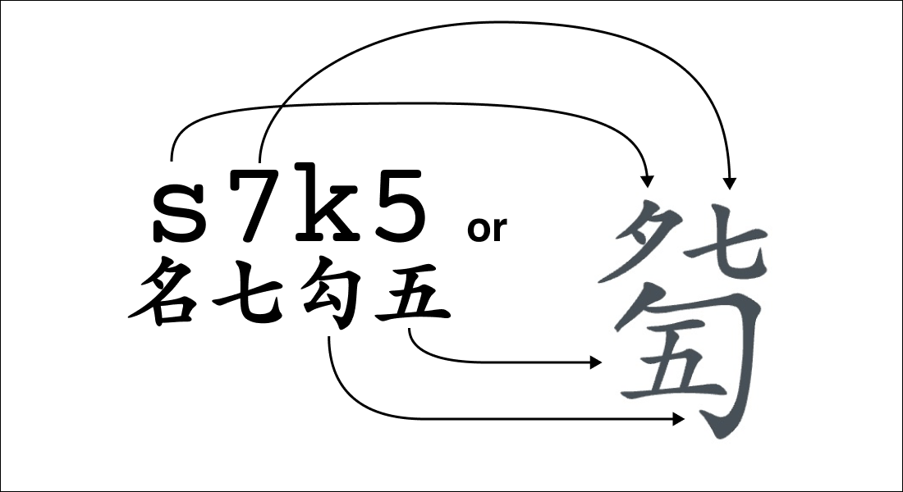

This document is about making the font: the Builder app and the engineering behind it.

For demo and info on how to use this font, please visit the [JianZiPu Font Website](https://jianzipufont.com). 

The JianZiPu font system is designed for rendering traditional Chinese guqin notation 减字谱 or JianZiPu. The font supports Chinese characters and ASCII input.

The JianZiPu font uses a glyph layering system where each musical notation character is built by combining multiple component glyphs that stack and position themselves relative to each other. So each character is made of a series of glyphs, similar to how an English word is made of a series of letters.



# The JZP Font Builder

The font is made in the **JZP Font Builder**, a web app (`app/`) served by a
small Python server. Everything you design happens there:

- **Glyphs**: draw, import or trace each component glyph, and see it in words
  as you go.
- **Typing**: how each glyph is typed (Latin entries, numbers, 简体 / 繁體), with
  clash checks.
- **Layouts**: how the parts of a character sit together, with spacing rules,
  areas and centering on a live canvas.
- **Test & Build / Tester**: build the font and type in it.

Start it on your machine:

```bash
cd builder
pip install -e .                # once
python3 -m jzpbuild.webserver   # open http://127.0.0.1:5713/
```

The app needs building once (`cd app && npm install && npm run build`), and the
base font `builder/src_font/TW-Kai-98.ttf`, which is not in the repo,
must be copied in once. Save in the Builder writes the files in
`builder/inputs/` (`design.json`, `components.csv`, `svg/`), which you
then commit. Invited testers use a hosted copy where their work stays in a
private draft until it is reviewed; see `builder/README.md` "Hosted pilot".

# The website

`site/` is the public font page at [jianzipufont.com](https://jianzipufont.com):
a static page that types in the released font. Cloudflare Pages deploys it from
`main` (output directory `site`, no build command). To publish a new font,
build it into the site and commit:

```bash
cd builder && python3 -m jzpbuild -o ../site/JianZiPu.ttf
```

The Builder itself runs at builder.jianzipufont.com (see `builder/README.md`
"Hosted pilot").

# Under the hood

The font is built by a Python pipeline in `builder/` (no FontForge, no
hand-edited feature files). The Builder runs it for you; from the command line
it is `cd builder && python3 -m jzpbuild` (writes
`builder/JianZiPu.ttf`). See `builder/README.md` for the
architecture, the inputs, and how the build is verified (a HarfBuzz shaping
regression test against a golden font).

The old manual pipeline (FontForge + `scripts.cjs`, the `.sfd` sources and the
v3.x backups) lived in `src-fontforge/` until 2026-10-18. It is kept in git
history under the tag `fontforge-final`.

---

The font is licensed under SIL Open Font License 1.1
The code is licensed under MIT License.
The font is derived from TW-Kai font.